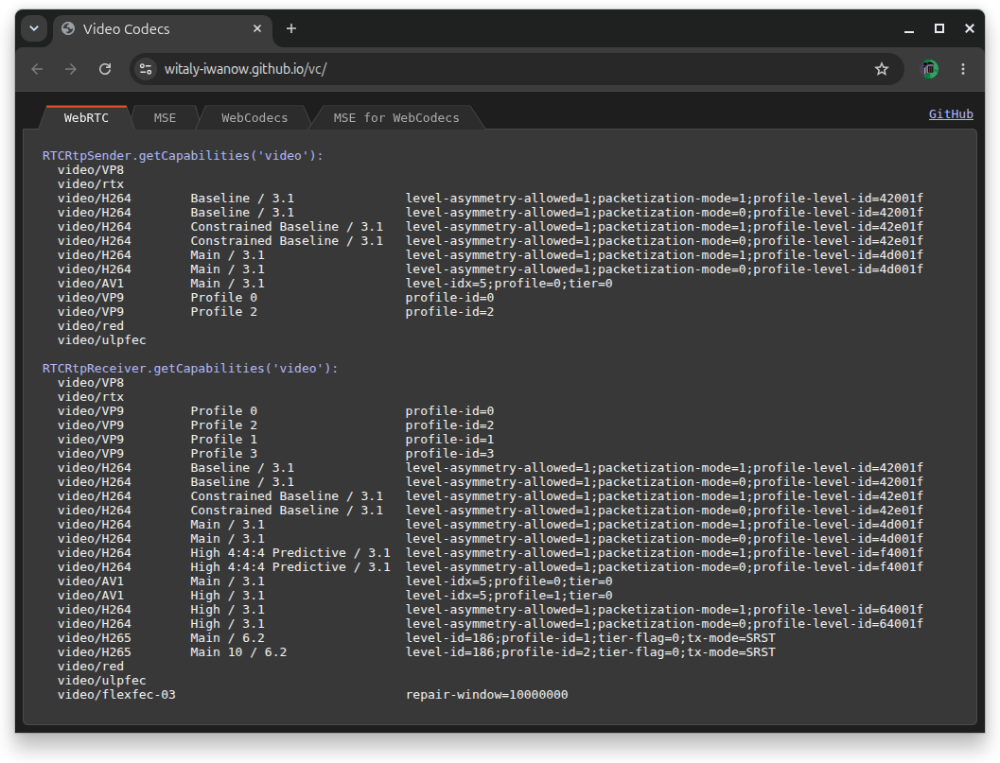

## Browser video codec support tests

A single static page that shows which video codecs the current browser supports through various APIs:
* WebRTC (`RTCRtpSender`/`RTCRtpReceiver.getCapabilities`)
* MSE (`MediaSource.isTypeSupported`)
* WebCodecs (`VideoDecoder`/`VideoEncoder.isConfigSupported`)
* [MSE for WebCodecs](https://github.com/wolenetz/mse-for-webcodecs/blob/main/explainer.md) (`MediaSource.addSourceBuffer({videoConfig})`)

No build step or dependencies: open `index.html` in a browser. WebCodecs requires a secure context, so serve it over HTTPS or from `localhost` (e.g. `python3 -m http.server`) if that tab reports it as unavailable.

[Live demo](https://witaly-iwanow.github.io/vc/)
